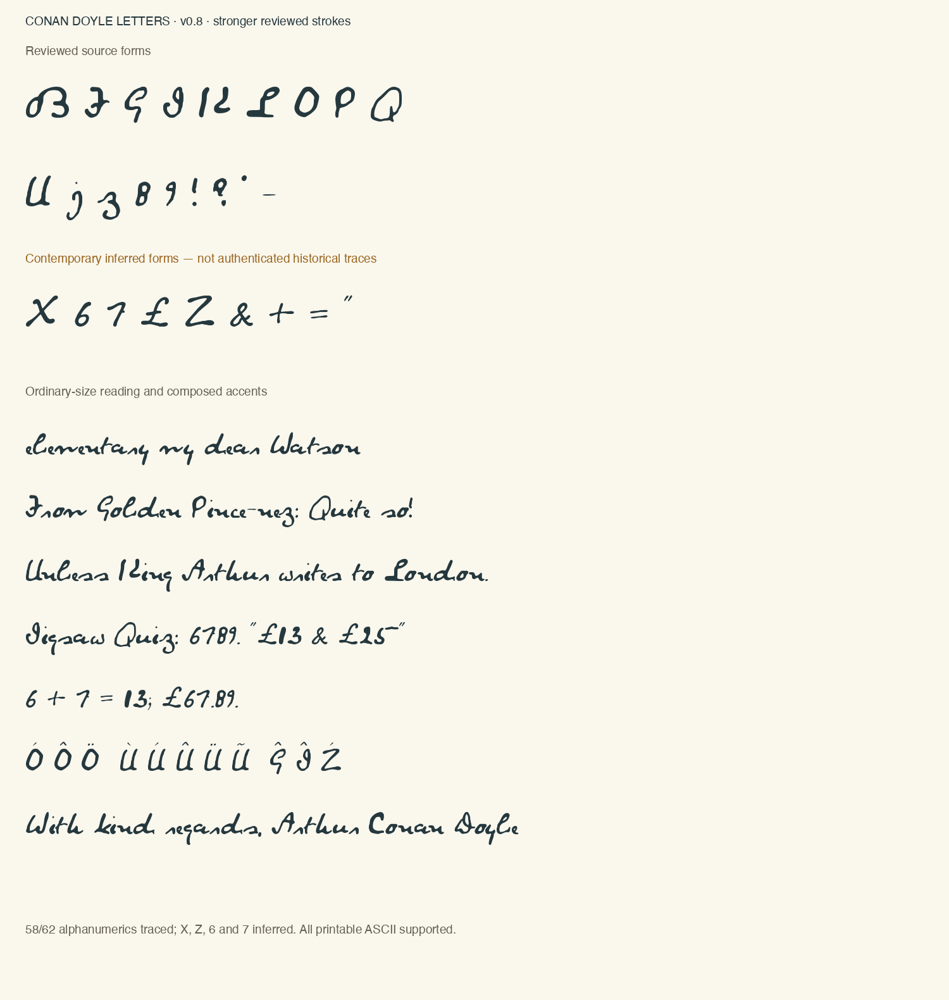

# Conan Doyle handwriting

An experimental font and offline handwriting desk based on attributed Arthur Conan Doyle handwriting. Free to use, study and improve, with source credits and inferred forms disclosed.



## Use

- **Font:** install [Conan Doyle Letters](outputs/conan-doyle-letters-study.ttf). Replace an older installation and restart apps that cache fonts.
- **Handwriting desk:** download the repository or release ZIP, then open [handwriting-desk.html](outputs/handwriting-desk.html) locally. It works offline, stores text/settings in your browser and exports SVG/PNG, including transparent backgrounds. No text is sent to a server.

The font supports all 95 printable ASCII characters and selected Latin/Welsh accents: 216 visible mappings, ordinary/nonbreaking spaces and an alternate capital A. The signature A is the default; the rounded body A is available in the desk and OpenType `ss01`.

## Fidelity and limitations

**58/62 English letters and digits are source-traced.** X, Z, 6 and 7 are contemporary inferred designs. Six punctuation forms are traced: period, comma, !, ?, apostrophe and dash. £, &, double quotes, + and = are inferred, as are the other unverified symbols. In total, 32 basic forms and seven accent marks use image-assisted designs; accents and smart aliases are composed.

These are distinct fixed forms assembled from different writing periods, not a complete reproduction of Doyle's handwriting. Generated forms are not historical attestations. The desk's amber status identifies inferred/composed characters, and unsupported characters appear as boxes. There is no claim of complete Unicode coverage or a completed archive search.

The desktop font and SVG desk share optical kerning. Supporting desktop apps must enable kerning. The desk's optional joins are inferred short bridges, not historical ligatures; font-proof mode adds none. The previous spacing treatment is available for comparison.

## Build

Python 3.10 or later:

```sh
python3 -m venv .venv
.venv/bin/python -m pip install -r requirements.txt
.venv/bin/python working/build-from-vectors.py
.venv/bin/python working/make-renderer.py
```

On Windows use `.venv\Scripts\python`. The vector build needs only FontTools and the included reviewed vectors; no scans, image service, API key or network access is needed after installing dependencies. A rebuild reproduces outlines, metrics and OpenType tables, rather than promising identical TTF timestamps.

Browser checks:

```sh
npm ci
npx playwright install chromium
npm test
```

`CHROME_EXECUTABLE` selects an existing Chrome/Chromium binary; `PLAYWRIGHT_MODULE` can select an existing Playwright installation.

## Licences and attribution

- **Software code:** [MIT](LICENSE).
- **Font, glyph vectors and artwork:** [Creative Commons Attribution-ShareAlike 2.0](LICENSE-FONT). Retain the source credits, licence link and modification notices; distribute adapted artwork under the same licence or a permitted later ShareAlike version.
- The HTML includes both MIT application code and CC BY-SA font/glyph artwork. An MIT code licence does not replace the embedded artwork's licence.

[Source credits and modifications](outputs/notice.md), [current source register](sources/source-register.json), [per-character provenance](sources/complete-provenance.json), [third-party tools](THIRD-PARTY-NOTICES.md).

Primary sources: Special Collections Toronto Public Library; Harry Ransom Center, The University of Texas at Austin; the public-domain-tagged 1886 draft on Wikimedia Commons. Original scans, paper figures, private notes and previous unresolved-source font versions are not included. Institutional US public-domain statements do not determine copyright status in every other country. No endorsement by the institutions or Doyle's estate is implied.

## AI-assisted work

The project was developed with AI coding assistance. ChatGPT Images supplied the explicitly inferred forms, using reviewed handwriting as a reference. The v0.8 [design master](working/image-design/generated-sheet-v08.png), [style reference](working/image-design/approved-reference-v08.png) and [exact prompt](outputs/image-design-prompt-v08.txt) are included. Other inferred forms and accent marks are frozen in the vector bank with provenance; no live image generation is required to build or use the font.

The approach was informed by *My Text in Your Handwriting* (Haines et al., 2016), but this project does not incorporate that system's AGPL engine or reproduce its paper figures.

This public repository starts with a reviewed v0.8 snapshot. Earlier personal research history was kept separately rather than published with unresolved source material.
